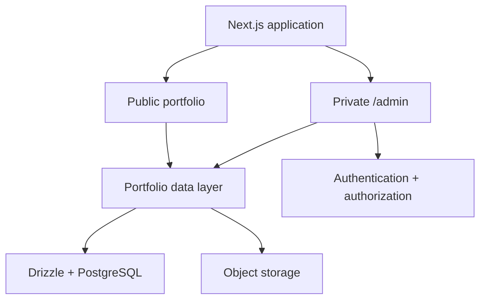
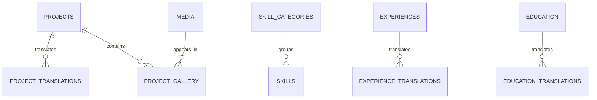

# My Portfolio — Admin Dashboard Specification

**Project:** `my-portfolio`  
**Owner:** Hen Kimheang  
**Document type:** Product requirements and technical implementation plan  
**Version:** 1.0 (proposed)  
**Date:** 26 October 2026  
**Status:** Planning — not yet implemented

> **Assumption:** This is a private, single-administrator dashboard built inside the existing Next.js portfolio. The public site already has a dark/neon design, responsive layouts, and English/Khmer language switching planned or implemented. Confirm these details against the repository before starting.

## 1. Executive summary

Build a secure content-management dashboard at `/admin` so the owner can update the portfolio without changing source code. The public website remains available to everyone; only an authorized administrator can create, edit, publish, or remove portfolio content.

The first release focuses on authentication and management of projects, skills, experience, education, profile information, and media. Content must support both English (`en`) and Khmer (`km`) while preserving the public website's visual theme and responsiveness.

### Goals

- Update portfolio content from a browser, without a Git commit or redeployment for each change.
- Manage English and Khmer descriptions of the same content item.
- Safely upload and reuse images across projects and profile sections.
- Publish or unpublish items, control their display order, and feature selected projects.
- Keep the current public portfolio design intact throughout migration.
- Use maintainable TypeScript modules, a relational database, and server-side access controls.

### Non-goals for v1

- Public user registration or social community features.
- Multiple administrators, teams, complex role hierarchies, or a public API for third-party clients.
- A page builder, drag-and-drop layout editor, or full blog CMS.
- Real-time traffic analytics and an internal contact inbox. These may be added later.

## 2. Users and access

| Actor | Access | Main activities |
| --- | --- | --- |
| Visitor | Public portfolio only | View projects, switch `en`/`km`, open project links, contact owner |
| Administrator | Public portfolio and `/admin` | Sign in, edit all content, manage media, preview, publish |

**MVP decision:** One allowlisted GitHub identity. Do not enable open sign-up. Check the authenticated provider account's stable identity on the server, not only a client-visible email. Use a supported auth library's session and CSRF protections.

## 3. Proposed technology stack

| Layer | Proposed technology | Notes |
| --- | --- | --- |
| Application | Existing Next.js App Router + TypeScript | Confirm actual router and installed versions first |
| UI | Existing Tailwind CSS + shadcn/ui where needed | Reuse existing components before adding dependencies |
| Authentication | Better Auth + GitHub OAuth | Private login; verify compatible versions and provider configuration |
| Database | PostgreSQL | Managed database recommended for deployment |
| Data access | Drizzle ORM + Drizzle Kit | Typed queries and versioned migrations |
| Validation | Zod | Shared server-side input schemas |
| Forms | React Hook Form, if not already present | Client form state and validation UX |
| i18n | Existing next-intl | Locale routing and interface labels; avoid second i18n library |
| Media | Cloudinary **or** S3-compatible object storage | Select one before implementation; store metadata in PostgreSQL |
| Deployment | Existing hosting, e.g. Vercel | Confirm database connectivity and environment variables |

**Dependency policy:** Inspect `package.json` and lockfile; reuse installed libraries. Install only the missing packages required for the chosen implementation. Do not introduce a separate NestJS API for v1.

### Architecture



Use a **modular monolith**: one deployable application, with independent feature modules for projects, skills, profile, experience, education, and media. Public reads and admin mutations share services/repositories but have different authorization policies.

## 4. Information architecture

### Public routes

- `/en` and `/km`: localized portfolio homepage.
- Project details or anchors follow the public site's existing routing convention.
- Keep existing links functional; add redirects only when necessary.

### Private routes

| Route | Screen | v1 |
| --- | --- | --- |
| `/admin/login` | Sign in using approved GitHub account | Yes |
| `/admin` | Summary, recent changes, quick actions | Yes |
| `/admin/profile` | Identity, biography, links, photo | Yes |
| `/admin/projects` | Search/list/filter/sort projects | Yes |
| `/admin/projects/new` | Create project | Yes |
| `/admin/projects/[id]/edit` | Edit localized fields and publishing state | Yes |
| `/admin/skills` | Skills and categories | Yes |
| `/admin/experience` | Work history | Yes |
| `/admin/education` | Education entries | Yes |
| `/admin/media` | Upload, browse, reuse, remove unused media | Yes |
| `/admin/settings` | Public contact/social links, site settings | Yes |
| `/admin/messages` | Contact inbox | Later |
| `/admin/analytics` | Visitor statistics | Later |
| `/admin/blog` | Articles | Later |

Keep `/admin` independent of the public `[locale]` segment. The admin interface can begin in English; portfolio content must be editable in English and Khmer.

### Navigation and UI

- Responsive left sidebar on desktop; collapsible drawer on small screens.
- Header with breadcrumb, current admin identity, theme toggle, and sign-out.
- Dashboard summary cards: total projects, published projects, skills, and experience entries.
- Consistent tables with search, loading/empty states, and safe confirmation dialogs.
- Accessible forms with visible labels, keyboard navigation, field errors, and success feedback.
- Prefer restrained animations so data-entry workflows stay fast and predictable.
- Dark mode should match the portfolio's visual identity; avoid intense neon effects inside long forms.

## 5. Functional requirements

### 5.1 Authentication

**ADMIN-01:** Only a pre-approved GitHub account may enter `/admin`.  
**ADMIN-02:** A visitor without a valid session is redirected to sign-in.  
**ADMIN-03:** All mutations and sensitive reads check authorization on the server.  
**ADMIN-04:** Sign-out invalidates the session and protects subsequent requests.  
**ADMIN-05:** There is no public admin sign-up screen.

### 5.2 Projects

**PROJ-01:** List projects with title, thumbnail, status, featured flag, sort order, updated date.  
**PROJ-02:** Create and edit localized project titles, summaries, and full descriptions.  
**PROJ-03:** Manage stable slug, technology tags, GitHub URL, demo URL, cover image, and gallery.  
**PROJ-04:** Save as draft, preview, publish, and unpublish.  
**PROJ-05:** Mark a project as featured and set display order.  
**PROJ-06:** Confirm destructive actions; prefer soft deletion or explicit archiving when feasible.  
**PROJ-07:** Public pages expose only published content.

### 5.3 Profile

**PROF-01:** Edit public display name, job title, portrait, email, location label, and social links.  
**PROF-02:** Edit biography and hero copy separately for `en` and `km`.  
**PROF-03:** Validate URL schemes and email format. Do not publish private account data.

### 5.4 Skills

**SKILL-01:** Create, rename, reorder, and remove skill categories.  
**SKILL-02:** Create skills with name, optional icon, category, proficiency label (optional), and display order.  
**SKILL-03:** Keep technology names in their customary spelling; use translations only for explanatory text.

### 5.5 Experience and education

**EXP-01:** Manage company/organization, role, employment type, start/end dates, current-role flag, location, display order.  
**EXP-02:** Store English and Khmer responsibilities/descriptions independently.  
**EDU-01:** Manage institution, degree/program, start/end dates, and localized descriptions.  
**EDU-02:** Consistently display ongoing positions/studies without inventing an end date.

### 5.6 Media library

**MEDIA-01:** Upload supported image formats and optionally PDF resumes.  
**MEDIA-02:** Enforce MIME-type checks, maximum file size, and server-issued upload permissions.  
**MEDIA-03:** Store media identifier, storage key, URL, dimensions (if image), alt text, owner, and timestamps.  
**MEDIA-04:** Prevent deletion of media currently referenced by published content unless replaced.  
**MEDIA-05:** Do not put images directly into PostgreSQL; use object storage.

### 5.7 Settings

**SET-01:** Edit public contact links, downloadable CV link, basic site metadata, and feature visibility flags.  
**SET-02:** Keep sensitive secrets (auth, database, storage keys) in server environment variables, never editable client settings.  
**SET-03:** Existing visitors' color-theme choices remain separate from admin content settings unless global theme defaults are explicitly implemented.

## 6. English and Khmer support

Two distinct translation mechanisms must coexist:

1. **Static interface strings** (buttons, navigation, errors) stay in existing `next-intl` `en.json` and `km.json` dictionaries.
2. **Editable content** (project titles, biographies, experience descriptions) lives in PostgreSQL translation tables indexed by locale.

Suggested rules:

- Supported content locales are `en` and `km`, using BCP 47 language tags.
- The admin editor shows separate English and Khmer tabs with a clear missing-translation indicator.
- Publishing requires all mandatory fields in **both** languages; draft saving may allow incomplete translation.
- Public content uses the requested locale. For optional untranslated fields, either fall back to English with a documented policy or omit that field; never silently mix languages unpredictably.
- Technology/product names can remain in English in both locales.
- Use Noto Sans Khmer for Khmer UI/content and test font rendering on iOS/Android.
- Locale switching on the public website does not change color theme or erase visitor preferences.

## 7. Database design (initial proposal)

### Core tables

| Table | Key fields | Relationships |
| --- | --- | --- |
| `projects` | `id`, `slug`, `status`, `featured`, `sort_order`, `cover_media_id`, timestamps | Media and translations |
| `project_translations` | `project_id`, `locale`, `title`, `summary`, `description` | Composite unique: (`project_id`,`locale`) |
| `skills` | `id`, `name`, `category_id`, `icon_media_id`, `sort_order`, timestamps | Category/media |
| `skill_categories` | `id`, `key`, `sort_order` | Skills |
| `experiences` | `id`, `organization`, `start_date`, `end_date`, `is_current`, `sort_order` | Translations |
| `experience_translations` | `experience_id`, `locale`, `role_title`, `description` | Composite unique |
| `education` | `id`, `institution`, `start_date`, `end_date`, `sort_order` | Translations |
| `education_translations` | `education_id`, `locale`, `program`, `description` | Composite unique |
| `profile` | `id`, `display_name`, `email_public`, `photo_media_id`, `social_links` | Translations/media |
| `profile_translations` | `profile_id`, `locale`, `headline`, `bio` | Composite unique |
| `media` | `id`, `storage_key`, `url`, `mime_type`, `size_bytes`, `alt_text`, timestamps | Referenced by content |
| `settings` | `key`, `value`, `updated_at` | Site configuration |
| Auth tables | Provider accounts, sessions, users, verification records | Managed according to chosen auth library |

**Design notes:**

- Use auto-incrementing integer IDs (Postgres identity columns); use explicit unique constraints for slugs and locale pairs. Public URLs use slugs, never IDs.
- Make `status` a constrained value such as `draft` or `published`.
- Preserve `created_at` and `updated_at` for editorial traceability.
- Use join tables for project technologies and gallery ordering rather than storing unstructured comma-separated strings.
- Create indexes for public published-project queries and admin sorting.
- Do not pre-populate fake metrics or content in production.

### Suggested relationships



## 8. Application architecture and code organization

Suggested structure (adapt to the actual repository; do not move working routes unnecessarily):

```text
src/
  app/
    [locale]/              # Public localized portfolio
    admin/
      login/
      (dashboard)/
        page.tsx
        projects/
        skills/
        experience/
        education/
        profile/
        media/
        settings/
    api/auth/              # Auth handlers
  components/
    admin/                 # Sidebar, header, tables, forms
    portfolio/             # Existing visitor-facing UI
  modules/
    projects/
      schema.ts            # Validation
      repository.ts        # Database access
      service.ts           # Business rules
      actions.ts           # Authenticated mutations
      components/
    skills/
    experience/
    education/
    profile/
    media/
  db/
    index.ts
    schema/
  lib/
    auth.ts
    authorization.ts
  i18n/
  messages/
    en.json
    km.json
drizzle/                    # Generated migrations
```

**Responsibilities:**

- **Components:** Presentation, field state, accessibility, and confirmation UI.
- **Server actions/route handlers:** Validate input, verify session and authorization, call services.
- **Services:** Enforce invariants (publish requirements, duplicate slug checks, references, ordering).
- **Repositories:** Drizzle queries and transactions.
- **Schema:** Drizzle DB definitions separate from Zod request validation.
- **Public pages:** Query published content, render requested locale, and revalidate after authorized mutations.

## 9. Main workflows

### Add and publish a project

1. Administrator signs in via GitHub.
2. Opens Projects → New Project.
3. Adds metadata, English/Khmer titles and descriptions, media, and technology tags.
4. Saves draft. Missing required translations remain visible as editorial warnings.
5. Reviews preview in both languages.
6. Selects Publish. Server validates required fields and admin permission.
7. Database commits changes. Cache is revalidated so public pages show the new project.

### Edit existing content

1. Find item by search or filter.
2. Open edit form with current database values.
3. Make changes, with client- and server-side validation.
4. Save; show success or field-level error.
5. Public published content updates without needing a new code deployment.

### Remove content

1. Administrator requests archive/delete.
2. UI identifies affected public links and referenced media.
3. User confirms. Server verifies permissions and relational constraints.
4. Prefer archive/unpublish for recoverability; permanent deletion is a separate explicit operation.

## 10. API and server action design

Use Server Actions for internal dashboard form submissions when appropriate. Use Route Handlers for authentication, signed media uploads, and external integrations. Do not add duplicate REST routes for every CRUD action unless genuinely needed.

Suggested service contracts:

| Module | Operations |
| --- | --- |
| Projects | `listProjects`, `getProject`, `createProject`, `updateProject`, `publishProject`, `unpublishProject`, `archiveProject` |
| Skills | `listSkills`, `createSkill`, `updateSkill`, `deleteSkill`, `reorderSkills` |
| Experience | `listExperiences`, `upsertExperience`, `archiveExperience` |
| Education | `listEducation`, `upsertEducation`, `archiveEducation` |
| Profile | `getProfile`, `updateProfile`, `updateProfileTranslation` |
| Media | `createUploadAuthorization`, `registerMedia`, `listMedia`, `deleteUnusedMedia` |

All mutation entry points must independently verify authenticated administrator status and validate inputs. Public reads must never expose drafts or private metadata.

## 11. Security and operational requirements

- Enforce admin authorization at the data/action boundary, even if the page layout also redirects.
- Store sensitive tokens, database URLs, OAuth secrets, and storage credentials server-side only.
- Use HTTPS, secure session cookies, least-privilege database credentials, and provider-supported protections.
- Validate and constrain uploads; do not trust filename extension alone.
- Escape/sanitize any user-authored rich text; prohibit unsafe HTML execution.
- Validate external links to prevent dangerous URL schemes.
- Rate-limit sign-in and high-risk endpoints according to hosting capabilities.
- Keep production and development credentials/databases separate.
- Run migrations in a controlled release step; back up production data before destructive migrations.
- Log admin mutations and unexpected errors without leaking secrets or personal information.
- Set security headers and review deployment platform protections as appropriate.
- Never assume hiding a button on the client protects its server action.

## 12. Migration from existing hardcoded content

1. Inventory current project cards, skills, profile, experience, education, and current translation dictionaries.
2. Define database schema and create versioned migrations.
3. Write a **repeat-safe** import/seed script for existing content; preserve URLs, slugs, order, and media references.
4. Validate imported English and Khmer text, and identify missing translations.
5. Change one public section at a time to read from the database.
6. Compare public output before/after migration (content, routes, SEO, theme, responsive behavior).
7. Remove duplicate hardcoded content only after successful verification.
8. Have a rollback plan and database backup before production cutover.

## 13. Development phases and deliverables

| Phase | Deliverables | Definition of done |
| --- | --- | --- |
| **0 — Audit** | Document actual Next.js version/router, installed libs, existing locale/theme structure and deployment | No speculative dependencies; migration risks identified |
| **1 — Foundation** | PostgreSQL, Drizzle schema/migrations, Better Auth GitHub login, server authorization | Unauthorized users cannot access or mutate admin data |
| **2 — Admin shell** | Responsive sidebar, header, overview cards, empty/loading/error states | Usable at mobile and desktop widths, keyboard accessible |
| **3 — Projects** | Project list/form, translations, publish workflow, preview, images | New published item appears in both locales |
| **4 — Other content** | Skills, experience, education, profile, settings | Public sections update through admin without code edits |
| **5 — Media and migration** | Storage integration, existing data import, public read refactor | No missing current content; upload restrictions enforced |
| **6 — Hardening** | Automated checks, security review, backup/deploy procedure | Production build passes; critical journeys verified |

### Delivery order

Start with a vertical slice: **sign in → create project draft → add EN/KM translations → publish → verify public site**. Reuse the successful approach for remaining content modules.

## 14. Acceptance criteria

### Functional

- [ ] Only the approved account can sign in; unauthorized accounts are denied.
- [ ] All private routes and mutating actions enforce server-side access control.
- [ ] Admin can create/edit/publish/unpublish at least one project.
- [ ] English and Khmer content are independently editable and correctly rendered.
- [ ] Draft content is not public.
- [ ] Public pages update after publishing without a code deployment.
- [ ] Skills, experience, education, and profile are manageable through admin.
- [ ] Images can be uploaded, previewed, reused, and safely removed when unused.
- [ ] Existing public sections, URLs, theme selection, cursor animation, and mobile experience remain functional.

### Quality

- [ ] TypeScript checks and project lint checks pass.
- [ ] Production build succeeds using supported environment variables.
- [ ] Core CRUD workflows have automated tests or documented repeatable manual checks.
- [ ] Authorization failures return appropriate responses.
- [ ] Forms show field-level validation errors and do not silently discard user input.
- [ ] Keyboard, touch, small mobile viewport, and both-language layouts are tested.
- [ ] Database migrations and recovery steps are documented.
- [ ] No secrets appear in source control, client bundles, or logs.

## 15. Risks and mitigation

| Risk | Mitigation |
| --- | --- |
| Existing portfolio structure differs from assumptions | Perform Phase 0 audit before changing routes |
| Locale route conflicts with `/admin` | Keep admin route outside `[locale]`; test precedence and redirects |
| Hardcoded and database content diverge | Migrate section by section and remove duplicates after validation |
| Khmer descriptions overflow UI | Test fonts, line height, dynamic widths, mobile layout |
| Auth integration admits unintended accounts | Stable provider-ID allowlist + server-side checks for all actions |
| Media storage changes or fails | Keep storage abstraction, stable media table, backups |
| DB writes fail during publication | Use transactions; revalidate cache after successful commit |
| Accidental destructive changes | Confirm UI actions, soft-delete where feasible, backups |

## 16. Decisions to confirm before implementation

1. **Admin identity:** Which GitHub account/provider account ID is authorized? Do not paste tokens or secrets into chat or source files.
2. **Hosting:** Where is the portfolio currently deployed?
3. **Database provider:** Existing PostgreSQL instance, Neon, Supabase, or another provider?
4. **Media provider:** Cloudinary or S3-compatible object storage?
5. **Content editing:** Plain text/Markdown for project descriptions or rich-text editor?
6. **Public sections:** Which sections are actually present today? Keep scope matched to the website.
7. **Localization status:** Is `next-intl` already implemented, and do public routes currently use `/en` and `/km`?

Until these are confirmed, the stack and routes above are **proposals**, not claims about the current repository.

## 17. Implementation kickoff checklist

Before coding:

1. Inspect `package.json`, Next.js router, Tailwind configuration, i18n files, navigation, and content sources.
2. Capture current public portfolio screenshots and a route inventory as a visual baseline.
3. Create a feature branch (e.g. `feat/admin-dashboard-foundation`).
4. Choose the database, OAuth identity, and media provider.
5. Define initial Drizzle schema and migration strategy.
6. Implement authenticated dashboard layout with strict server authorization.
7. Deliver the projects vertical slice and test both languages.
8. Continue by module, preserving existing public behavior.

## 18. Official references

- [Next.js — Authentication](https://nextjs.org/docs/app/guides/authentication)
- [Next.js — Data security](https://nextjs.org/docs/app/guides/data-security)
- [Drizzle ORM — PostgreSQL](https://orm.drizzle.team/docs/get-started/postgresql-new)
- [Better Auth — Installation](https://better-auth.com/docs/installation)
- [Better Auth — OAuth](https://better-auth.com/docs/concepts/oauth)
- [next-intl — Documentation](https://next-intl.dev/docs/getting-started)

---

**Recommended first milestone:** A secured, responsive admin dashboard that allows Hen Kimheang to publish one bilingual project to the existing public portfolio. All other content modules can follow the same architecture.
